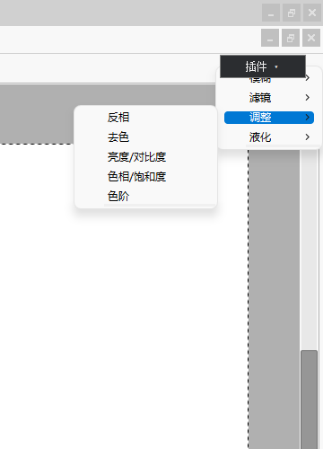

# SAI2 插件套件 · SAI2 Plugin Suite

给 **PaintTool SAI2** 补上**模糊 / 滤镜库 / 调整 / 液化**四类图像处理能力。

SAI2 没有官方插件接口（实测无导出表、无扩展机制），所以这里走的是
「**伴随宿主 + 剪贴板桥 + 只读注入代理**」：插件跑在旁边的面板进程里，通过 Windows
剪贴板与 SAI2 交换图像，注入代理只读观察 SAI2 的图层面板。**不改 SAI2 一行代码。**


> **项目出处**：派生自 [PainterAnkry/sai2-plugin-suite](https://github.com/PainterAnkry/sai2-plugin-suite)（MIT）。
> 本仓库在导入上游代码后合入了第一批稳定性 / 正确性 / 性能修复，
> 差异清单见 [本仓库与上游的差异](#本仓库与上游的差异)，评审原文见
> [docs/代码评审与优化建议.md](https://git.celery-play-game.top/owner/sai2-plugin-suite/src/branch/main/docs/代码评审与优化建议.md)。

> **第一次用、不想读文档？** 直接看 **[docs/小白教程.md](小白教程.md)** ——
> 从下载、解压、加白名单到第一次出图，每一步都写了"你应该看到什么"。



> 注入成功后 SAI2 菜单栏右侧多出「插件」菜单，点任一子项即抓取当前图层并打开对应功能窗口。
> （截图来自旧版，调整菜单里的「色阶」现为「曲线」。）

---

## 目录

- [功能](#功能)
- [快速开始](#快速开始)
- [快捷键](#快捷键)
- [工作原理](#工作原理)
- [常见问题](#常见问题)
- [从源码构建](#从源码构建)
- [测试与验证](#测试与验证)
- [仓库结构](#仓库结构)
- [本仓库与上游的差异](#本仓库与上游的差异)
- [已知限制](#已知限制)
- [许可证与致谢](#许可证与致谢)

---

## 功能

**一功能一窗口**：点面板按钮 → 自动在 SAI2 里选中当前图层并复制 → 抓取像素 → 弹出独立窗口。
窗口可缩放、可平移、位置记忆，每个窗口有独立的预览会话（互不干扰）。

| 窗口 | 内容 | 说明 |
| --- | --- | --- |
| **模糊** | 9 种：高斯 / 方框 / 动感 / 径向 / 表面 / 特殊 / 镜头 / 平均 / 透视模糊 | 高斯走 DX11 compute shader，其余 CPU；半径类参数在预览时按倍率缩放 |
| **滤镜** | 53 个：47 个 Photoshop 滤镜 + 6 个手写滤镜（马赛克 / USM 锐化 / 添加杂色 / 色差 / 泛光 / 路径模糊） | 缩略图墙实时生成，右侧参数面板 |
| **调整** | 10 种：反相 / 去色 / 阈值 / 色调分离 / 亮度对比度 / 色阶 / 色相饱和度 / 色彩平衡 / 渐变映射 / 曲线 | 曲线是 PS 风格面板（直方图 + 可拖控制点 + 分通道）；渐变映射内置 6 组渐变 |
| **液化** | 8 个工具：向前变形 / 重建 / 平滑 / 顺时针 / 逆时针 / 褶皱 / 膨胀 / 左推 | 置换场 + 逆映射，笔画级撤销（Ctrl+Z），按住不动持续施力；图层列表 `Ctrl`/`Shift` 多选后可**多层同一形变**（分层不丢） |

**其它**

- **注入代理**：只读识别 SAI2 图层面板（图层名 / 缩略图 / 高亮行），面板里点某一行即在 SAI2 选中该层
- **精确回贴**：抓图时同时定位画布，处理结果补边成整幅画布再粘贴，位置与原层一致
- **回贴原层**：可选「应用后合并回原层」，结果只作用在目标图层
- **叠加处理**：在当前结果上继续处理，便于连续叠效果
- **全局热键**：抓取 / 应用 / 撤销 / 复位
- **缩时摄影**：面板右下角「● 录制缩时」点一下开始，再点一下停止并生成 mp4
  （每 2 秒抓一帧、画面没变自动跳过、H.264 编码，输出到 `timelapse/` 目录）。
  旁边的「画布 / 整窗」选择录制范围：**画布**只录纸面（默认），**整窗**连工具栏一起录；
  「2s」切换抓帧间隔（1/2/5 秒），「目录」直接打开输出文件夹；录制中可「⏸ 暂停 /
  ▶ 继续」（同一段视频续录，文件不会重开），「1080p / 2K」切换输出长边
- **笔刷导入**：面板右下角「笔刷导入」选 `.abr` / `.sut`，自动把里面的笔尖
  转成 SAI2 的「笔刷形状」（写 `blotmap\` + `brushform.conf`），不用手动复制纹理；
  首次选择 SAI2 安装目录后记住。命令行等价：`sai2_bridge.exe --brush-convert <SAI2目录> a.abr b.sut`
- **描边 / 黑白覆盖 / Lab 取色器 / 钢笔曲线 / Alt+P 对比 / 选区移动**：1.61 新增
- **自动动作**：工具 → 动作，录制效果链（效果+参数+选区），存 `.sai2act`，一键回放
- **多图层批量调色**：选中多个图层后应用一次，其余层自动套同一效果（模糊/滤镜/调整；暂不支持选区）
- **选区**：任意功能窗口里 **Shift + 左键拖** = 矩形选区（同时按 Ctrl = 椭圆），
  **Alt + Shift + 拖** = 套索，**Shift + 单击** = 魔棒，**Ctrl+Shift + 单击** = 钢笔（Enter/点回首点闭合），**F** 循环羽化，**`[`/`]`** 调魔棒容差，`Ctrl+Shift+I` 反选，`Ctrl+D` 清除。
  效果只作用于选区，选区之外像素保持原样（宿主侧按掩码合成，
  模糊/滤镜/调整/液化都生效）
- **历史记录**：面板状态栏的「历史」把日志区切成步骤列表，点任意一步即可回到
  那次应用之前（后面的步骤会被丢弃），等价于连续撤销到那一步
- **渐变编辑器**：渐变映射窗口里直接编辑色标——点渐变条加一个、拖动改位置、
  `Delete` 删除、点「改色」选颜色；「保存 / 加载」读写 `.grad` 预设，「复位」
  回到黑白
- **统计**：状态栏「统计」显示绘画时间 / 摸鱼时间 / 笔画数 / 落笔数，面板里
  一键清零（判断自己是在画画还是在摸鱼）
- **黑白监看**：状态栏「黑白」把画布预览按亮度显示（只影响查看，不改原图），
  调明度/素描类效果时看关系更准
- **屏幕取色**：点状态栏「取色」，鼠标移到任意位置，左键复制 `#RRGGBB`，
  状态栏同时显示 RGB / HSV（Esc 或右键取消）
- **主题与字体**：右键顶栏的主题按钮 → 改强调色、字体 90% / 100% / 110% / 120%，
  以及快捷键方案（Ctrl+Alt / Ctrl+Shift / Alt+Shift）
  （都记在注册表）

## 快速开始

> 需要 **Windows 10 / 11 x64**，**SAI2 必须是 64 位版**。无需额外安装运行库。

1. 到 **[Releases](https://git.celery-play-game.top/owner/sai2-plugin-suite/releases)** 下载 `sai2-plugin-suite-1.64.0.zip`，解压到任意目录
   （路径可以含中文）。包内已带齐 `sai2_bridge.exe` / `sai2_agent.dll` /
   `sai2_injector.exe`、`plugins/`、两个启动脚本和本文档。
   也可以按下文「[从源码构建](#从源码构建)」自行编译，再用
   `python scripts/make_release_zip.py` 打出同样的包。
2. **右键「以管理员身份运行」`添加白名单.bat`**（发布包内附带）：把本目录加入 Windows
   Defender 排除项。注入用的 `sai2_agent.dll` 是杀软重点关注对象，不加白名单可能被静默拦截
   （360 / 火绒等第三方杀软请在各自的信任区手动添加本目录）。
3. 启动 SAI2 并打开一幅画。
4. 双击 `启动插件面板.bat`（发布包内附带；从源码构建时直接运行
   `build-zig/tools/sai2_bridge.exe`）。
5. 点面板上的「**连接注入**」→ 图层列表出现即就绪（SAI2 菜单栏右侧也会多出「插件」菜单）。
6. 点「模糊 / 滤镜 / 调整 / 液化」中任一项 → 打开功能窗口 → 调参数 → 点「**应用 → 剪贴板**」→
   自动切回 SAI2 粘贴回原图层。

**权限级别要和 SAI2 保持一致**：「连接注入」失败最常见的原因是 SAI2 以管理员身份运行、
而面板没有。画面板上的「管理员重启」即可（会自动弹 UAC）。

## 快捷键

| 按键 | 作用 |
| --- | --- |
| `Ctrl+Alt+G` | 抓取（当前 SAI2 图层 / 剪贴板） |
| `Ctrl+Alt+A` | 应用并回写剪贴板（并自动粘贴回 SAI2） |
| `Ctrl+Alt+Z` | 撤销上一次应用 |
| `Ctrl+Alt+R` | 复位到刚抓取到的原图 |
| `Ctrl+Alt+1` / `2` / `3` / `4` | 打开 模糊 / 滤镜 / 调整 / 液化 窗口 |
| 画布滚轮 | 以光标为锚缩放（2% ~ 3200%，过 100% 吸附） |
| 画布右键拖动 | 平移 |
| `[` / `]` | 液化笔刷大小 |
| `Shift+[` / `Shift+]` | 液化笔刷压力 |
| `Ctrl+Z` | 液化窗口：撤销上一笔涂抹；其它窗口：撤销上一次应用 |
| `Esc` | 关闭当前功能窗口 |
| `Tab` / `Shift+Tab` | 在参数数值框之间跳格（`↑`/`↓` 为 ±1，`Shift` 为 ±10） |

## 工作原理

```
        ┌──────────────────────┐   Ctrl+A / Ctrl+C、Ctrl+V（剪贴板 CF_DIBV5）
        │   SAI2（64 位进程）   │◀──────────────────────────────┐
        │                      │                               │
        │  sai2_agent.dll      │  IAT 钩子：ExtTextOutW /       │
        │  只读观察图层面板     │  DrawTextW / SetDIBitsToDevice │
        └──────────┬───────────┘                               │
                   │ 命名管道 \\.\pipe\sai2agent（JSON 行协议）  │
        ┌──────────▼───────────┐        ┌───────────────────────┴──┐
        │ sai2_injector.exe    │        │ sai2_bridge.exe           │
        │ 注入 / 卸载 / 查询    │        │ 主面板 + 4 个功能窗口      │
        └──────────────────────┘        │  └ 插件宿主（sdk/host）   │
                                        │     └ com.sai2.blur 等 DLL │
                                        └───────────────────────────┘
```

- **图像往返**：SAI2 复制 → 读 `CF_DIBV5` → RGBA8 → 跑插件 → 写回 `CF_DIBV5`（保留 alpha）
  → 切回 SAI2 → `Ctrl+V`。只写 `CF_DIBV5`：同时给 `CF_DIB` 会让 SAI2 读到没有 alpha 语义的
  那份，透明区粘贴后变黑。
- **插件模型**：每个插件是独立 DLL + `manifest.json`，实现 `sai2::IPlugin`，通过
  `IHostContext` 拿图像 / 选区 / Undo / 参数通道 / 计算后端，不直接触碰 SAI2。
  宿主加载/卸载/异常隔离/自动禁用，插件崩溃不会带走面板。
- **参数通道**：宿主用键值字符串下发参数（`blur.radius=8`、`filter.param.strength=1.2`…），
  插件缺省时回落到自身默认值 —— 同一份插件在没有参数通道的宿主里行为不变。
- **预览与提交**：预览在降采样图上跑（像素半径类参数按倍率缩放），提交时按全分辨率跑一遍。

## 常见问题

| 现象 | 处理 |
| --- | --- |
| 「连接注入」一直未连接 | ① 权限级别不一致（见上文）；② 白名单没加、`sai2_agent.dll` 被杀软拦了；③ SAI2 不是 64 位 |
| 连接成功但图层列表为空 | SAI2 版本差异导致 IAT 钩子没命中；此时用「从剪贴板抓取」（自己在 SAI2 里 Ctrl+C）同样能工作 |
| 抓到的图只是图层包围盒 | 画布定位失败（图层被完全遮挡 / 画布几乎全白）。换一层或勾选「精确回贴」后重抓 |
| 粘贴回去位置偏了 | 未取得画布上下文；重新抓取并确认状态栏显示「整幅」 |
| 粘贴后透明区域变黑 | 旧版会同时写 `CF_DIB`，现已只写 `CF_DIBV5` |
| 液化拖动很卡 | 已知限制：预览目前按全分辨率渲染，大画布上延迟明显（见[已知限制](#已知限制)） |
| 8K 大画布点「应用」要等几秒 | 全分辨率滤镜是 CPU 密集操作，且暂时没有进度条 |

更细的用法与排障见 [docs/使用说明.md](使用说明.md)。

## 从源码构建

无第三方依赖；`zig c++` 一条命令构建全部产物（插件 DLL、面板、注入器、测试）。

```bash
pip install ziglang            # 或者自行安装 zig 并加入 PATH
export ZIG=/path/to/zig        # 可选；不设则依次找 $ZIG → PATH → pip 安装位置
bash scripts/build-zig.sh      # 产物在 build-zig/

python scripts/make_release_zip.py   # 可选：打成可分发的 zip（含 SHA-256）
```

发布包的内容（`dist/sai2-plugin-suite-<ver>.zip`）：3 个可执行文件、4 个插件的
DLL + manifest、两个启动脚本、README / LICENSE / 使用说明 / 小白教程 / 截图，
共 24 个文件，zip 约 3.0 MB（解压约 6 MB）。

也可以用 CMake（MSVC 或 MinGW）：

```bash
cmake -S . -B build
cmake --build build --config Release
```

首次构建几分钟（zig 首次运行还要建自己的缓存）。产物：

```
build-zig/
  plugins/           helloworld / blur / liquify / filtergallery / adjust .dll
  tools/sai2_bridge.exe     面板（4 个功能窗口 + --selftest / --uitest）
  tools/sai2_agent.dll      注入代理
  tools/sai2_injector.exe   注入 / 卸载 / 查询
  tools/sai2_fakehost.exe   假 SAI2，用于注入链路自检
  tests/sai2_tests.exe      单元测试
```

## 测试与验证

```bash
./build-zig/tools/sai2_bridge.exe --selftest --out out   # 端到端自检（不需要 SAI2）
./build-zig/tools/sai2_bridge.exe --uitest=3             # 界面冒烟：开全部窗口、绘制、退出
./build-zig/tests/sai2_tests.exe blur                    # 单个套件
./build-zig/tools/sai2_injector.exe selftest             # 注入链路（配合 sai2_fakehost.exe）
```

本机（Windows 11，zig 0.17.1）实测：

- 全量构建通过，`-Wall -Wextra` 下无 error
- `sai2_tests`：16 个算法套件 + `plugin_lifecycle` 全部 PASS
- `--selftest`：**PASS=174 FAIL=0**（含剪贴板往返无损、65 项效果逐个全分辨率应用、
  液化 8 工具、画布定位回归、撤销/复位/叠加语义）
- `--uitest=3`：正常创建全部功能窗口、绘制、退出（exit 0）

## 仓库结构

```
sdk/        插件 API 契约 + ImageBuffer / Selection（头文件 + 静态库）
host/       插件加载 / 注册表 / 安装 / 验签 / 日志 / Undo / 计算后端（DX11 + CPU）
plugins/    blur · liquify · filter-gallery · adjust · helloworld（各自独立 DLL）
tools/bridge/     sai2_bridge.exe：主面板 + 四个功能窗口 + 笔刷导入（ABR/SUT）+ 自检
tools/agent/      sai2_agent.dll：注入 SAI2 的只读观察代理（IAT 钩子 + 命名管道）
tools/injector/   sai2_injector.exe：注入 / 卸载 / 查询 CLI
tests/      17 个测试套件（无第三方框架）
docs/       开发者指南 · 使用说明 · 插件 SDK · 注入原理 · 代码评审
packaging/  发布包里的启动脚本（启动插件面板 / 添加白名单）
scripts/    构建脚本 · 发布打包（make_release_zip.py）· 演示视频生成
```

开发入手点：[docs/DeveloperGuide.md](https://git.celery-play-game.top/owner/sai2-plugin-suite/src/branch/main/docs/DeveloperGuide.md)（新增插件三步）、
[docs/PluginSDK.md](https://git.celery-play-game.top/owner/sai2-plugin-suite/src/branch/main/docs/PluginSDK.md)（API 契约）、[docs/SAI2Injection.md](https://git.celery-play-game.top/owner/sai2-plugin-suite/src/branch/main/docs/SAI2Injection.md)（注入原理）、
[docs/BrushImport.md](https://git.celery-play-game.top/owner/sai2-plugin-suite/src/branch/main/docs/BrushImport.md)（ABR/SUT 笔刷导入的格式与实现）、
[docs/FeatureMatrix.md](https://git.celery-play-game.top/owner/sai2-plugin-suite/src/branch/main/docs/FeatureMatrix.md)（与市面同类插件的功能对照）、
[docs/AutoActionFeasibility.md](https://git.celery-play-game.top/owner/sai2-plugin-suite/src/branch/main/docs/AutoActionFeasibility.md)（CSP 式自动动作的可行性研究）。

## 本仓库与上游的差异

本项目源自 **[PainterAnkry/sai2-plugin-suite](https://github.com/PainterAnkry/sai2-plugin-suite)**。
本仓库是它的派生版本，在导入代码的同时合入了第一批评审修复（详见
[docs/代码评审与优化建议.md](https://git.celery-play-game.top/owner/sai2-plugin-suite/src/branch/main/docs/代码评审与优化建议.md)）：

**稳定性**

- 抓取线程不再直接改 `BridgeCore`（画布上下文与日志经 `PostMessage` 交回 UI 线程），
  消除与 `WM_PAINT` 的无锁竞争；退出前支持取消并 join 抓取线程
- 注入线程的输出改由消息交回 UI 线程，不再跨线程写宿主状态
- 插件对象改由新增导出 `sai2_DestroyPlugin` 在插件模块内析构，之后才 `FreeLibrary`
- ZIP 安装补上中央目录条目边界、STORED 前后长度一致性与条目大小校验

**正确性**

- 修复可分离滤波竖直 pass 的越界读（选区不贴图像上下边时读越界堆内存）
- SmartBlur 的满幅值按像素格式取（RGBA8 上原实现按 256 回绕，输出伪彩）
- 阈值 / 高光按像素格式归一（16 位阈值恒成立、8 位镜头模糊高光永不触发）
- `ImageBuffer::SetPixel` 改为饱和夹取（原 `& 0xFF` 回绕）

**性能**

- 高斯统一 `sigma = radius / 2`，DX11 抽头半径 `ceil(2σ)`、上限 63
  （原来 15 tap 会在半径 >15 时静默截断，滑杆后半段几乎无效）
- `ImageBuffer` 新增 `Row()/Row16()` 行指针；`Clear` / `FillRect` 改整行 `memcpy`，
  `Convert` 改直接字节展开
- 移除 DX11 后端每次调用多余的一次 `Flush()`

**工程**

- CMake 补齐 `sai2_bridge` 漏掉的 8 个源文件（原先链接必然失败）、`AgentToolbar.cpp`、
  3 个测试套件
- `build-zig.sh` 的 zig 改为 `$ZIG → PATH → 本地 pip` 查找；`-Wno-everything` 换成
  `-Wall -Wextra`（并修掉因此暴露的窄化错误）
- 文档里的剪贴板格式、滤镜数量、色阶→曲线等描述对齐代码

## 已知限制

- **8 位往返**：剪贴板是 32bpp DIB，16 位 / 32 位浮点图层的精度会在往返中降到 8 位
- **选区不下发**：伴随宿主不向插件传选区，效果作用于整层（SDK 与各内核已支持 mask，
  缺的是从 SAI2 拿选区）
- **液化预览**：目前按全分辨率渲染，8K 画布上拖动有明显延迟；改回像素预算需要先把
  置换场改成归一化坐标（否则预览/提交尺寸不一致会重置笔画）
- **注入依赖 IAT 钩子**：SAI2 大版本换成新编译器/加壳后钩子可能失效，此时「从剪贴板抓取」
  仍然可用
- **无反调试保护**：全分辨率滤镜没有进度条与取消，大画布上是同步阻塞

## 许可证与致谢

[MIT](LICENSE) © 2026 PainterAnkry，派生版本修改 © 2026 Celery。

- 上游项目：[PainterAnkry/sai2-plugin-suite](https://github.com/PainterAnkry/sai2-plugin-suite)
- 本仓库：<https://git.celery-play-game.top/owner/sai2-plugin-suite>
- 本项目与 SAI2 官方无关，SAI2 是 SYSTEMAX 的产品；本套件不修改、不重分发 SAI2 本体

欢迎 issue / PR；提 bug 时请附 `logs/bridge.log`、`logs/plugin.log` 与
`设置 SAI2_BRIDGE_DIAG=1` 后的 `logs/ui-diag.log`。
